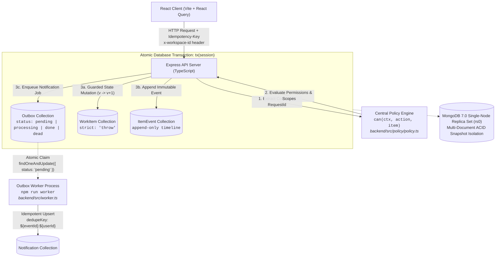

# Engineering Decisions: Operations Under Pressure

Newtonite is a high-concurrency work-item coordination engine designed to guarantee zero data loss, zero lost updates, and zero phantom notifications during incident surges. When dozens of operators simultaneously triage, claim, edit, approve, and resolve shared operational records, standard web patterns collapse into race conditions, stale overwrites, and state drift. I designed the platform around mathematical invariants enforced at the persistence layer, pairing multi-document ACID transactions with database-level atomic claim primitives, optimistic version locking, a transactional outbox queue, and a pure central authorization policy.

## Executive Summary (Core Decisions at a Glance)

1. **Multi-Document ACID Transactions**: Encapsulates work item state mutations, immutable audit events (`ItemEvent`), and outbox notification jobs in atomic MongoDB replica-set transactions (`tx(session)`), eliminating phantom alerts and orphaned records on failure.
2. **Atomic Claim & Optimistic Concurrency Control**: Resolves claim races at wire speed via atomic conditional updates (`findOneAndUpdate({ ownerId: null })`) and write contention via `version: expectedVersion` checks, backed by in-browser draft preservation and side-by-side diffing on HTTP 409.
3. **Transactional Outbox Pattern**: Decouples async notifications into a dedicated background worker with 60s lease locks (`lockedUntil`), idempotent consumer deduplication (`${eventId}:${recipientId}`), exponential retry backoff, and dead-letter queue routing.
4. **Pure Central Authorization & 404 Existence Hiding**: Enforces resource-level team scoping and strict separation of duties (prohibiting self-approval) via a pure `can(ctx, action, item)` policy, returning HTTP 404 on unauthorized resources to conceal confidential ticket existence.
5. **Cursor Pagination & Crash-Safe Idempotency**: Employs opaque cursor pagination `[updatedAt, _id]` backed by compound covered indexes to prevent feed drift under concurrent writes, paired with lease-reclaiming idempotency that purges 4xx/5xx errors to allow instant corrected retries.



---

## 1. Persistence & Multi-Document ACID Transactions

### Context / Problem
Under peak crisis triage, an operator claims or resolves an incident. This single business action requires updating the work item state, recording an immutable audit event (`ItemEvent`) for regulatory compliance, and queuing an asynchronous notification job (`OutboxJob`). In non-transactional databases or distributed setups without atomic commits, a network hiccup or crash midway leaves the system corrupted: an item is marked resolved, but the audit trail has no record of who resolved it, or a notification job is enqueued for an update that rolled back (a phantom notification).

### Options Considered
1. **PostgreSQL**:
   - *Pros*: Battle-tested relational ACID transactions, native row-level locking (`SELECT ... FOR UPDATE`), standard isolation levels (`READ COMMITTED`, `SERIALIZABLE`), and native `SKIP LOCKED` for queue consumers.
   - *Cons*: Rigid tabular schemas require complex join models and relational migrations for polymorphic audit payloads and JSON metadata diffs.
2. **MongoDB Standalone**:
   - *Pros*: Flexible document model, rapid setup.
   - *Cons*: Standalone MongoDB explicitly disables multi-document transactions (`"Transaction numbers are only allowed on a replica set member or mongos"`). Mutation atomicity across `WorkItem`, `ItemEvent`, and `OutboxJob` would be mathematically impossible.
3. **MongoDB 7.0 Single-Node Replica Set (`rs0`) (Chosen)**:
   - *Pros*: Unlocks complete multi-document ACID transactions with snapshot isolation; permits schema flexibility for structured field diffs while enforcing strict validation via `{ strict: 'throw' }` on the core domain entity.
   - *Cons*: Requires running with replication enabled (oplog), incurring write overhead.

### Choice
I configured MongoDB 7.0 as a single-node replica set (`rs0`) via `docker-compose.yml` with automated healthcheck initiation (`rs.initiate(...)`). I implemented a transactional helper in `backend/src/utils/transaction.ts`:

```typescript
export async function tx<T>(fn: (session: ClientSession) => Promise<T>): Promise<T> {
  const session = await mongoose.startSession();
  try {
    let result: T;
    await session.withTransaction(async () => {
      result = await fn(session);
    });
    return result!;
  } finally {
    await session.endSession();
  }
}
```

Every mutating workflow in `backend/src/services/item.service.ts` encapsulates the work item update, `ItemEventModel.create()`, and `OutboxJobModel.create()` within this single transaction session. If any document write fails, MongoDB rolls back all writes.

### Why
The brief mandates reliable coordination across thousands of active tickets and hundreds of concurrent operators. Without atomic multi-document transactions, audit log integrity and notification correctness cannot be guaranteed under crash conditions.

### Trade-offs & Mitigations
- *Trade-off*: Multi-document transactions hold snapshot locks and write to the oplog, increasing write latency compared to uncoordinated individual writes.
- *Mitigation*: I kept transaction scopes minimal and surgical. Only state mutations requiring audit trail synchronization run inside `tx(session)`. All read pipelines (cursor pagination, text search, and attention dashboards) execute outside transactions using compound covered indexes.

### How It's Tested
- `backend/src/__tests__/transactions.test.ts`: Test 8 injects a simulated database exception during `ItemEvent` insertion inside `tx(session)`. It asserts that the entire transaction rolls back—the work item remains in its original state, no partial audit events exist, and no outbox jobs are committed.

### At 10x Scale
At 10x scale (millions of events), this transitions from a single-node replica set to a 3-node primary-secondary-secondary replica set deployed across distinct availability zones, separating transactional writes on the primary from read-only reporting queries directed to secondaries via read preference `secondaryPreferred`.

---

## 2. Concurrency Control: Optimistic Version Locking, Atomic Claim, and Draft Reconciliation

### Context / Problem
In an active outage, multiple engineers simultaneously attempt to claim an unassigned ticket, or two operators open the same high-priority ticket and submit conflicting edits (e.g. Operator A changes priority to `LOW` and adds notes, while Operator B changes priority to `URGENT`). With standard read-modify-write patterns, Operator B silently overwrites Operator A's work (the classic lost-update anomaly), or both operators believe they own the ticket (double claim).

### Options Considered
1. **Pessimistic Row Locking (`SELECT FOR UPDATE` / Mutexes)**:
   - *Pros*: Completely prevents concurrent access while an operator views an item.
   - *Cons*: In distributed environments, locks held while an operator reads a screen create artificial bottlenecks. If a client disconnects or crashes without releasing the lock, items remain frozen until lock timeouts expire.
2. **Application-Level Read-Check-Write**:
   - *Pros*: Easy to write in application code (`if (!item.ownerId) { item.ownerId = userId; item.save(); }`).
   - *Cons*: Fatally vulnerable to Time-of-Check to Time-of-Use (TOCTOU) race conditions. Two concurrent HTTP requests can both read `ownerId === null` before either commits.
3. **Database-Level Atomic Conditionals + Optimistic Version Locking (Chosen)**:
   - *Pros*: Operates via atomic database query primitives (`findOneAndUpdate`). No locks held across network round-trips. Zero risk of distributed deadlocks.
   - *Cons*: Losers of a race receive HTTP 409 Conflict and must reconcile their changes.

### Choice
I implemented two distinct concurrency primitives in `backend/src/services/item.service.ts`:

1. **Atomic Claim**:
   ```typescript
   const updated = await WorkItemModel.findOneAndUpdate(
     { _id: itemId, workspaceId: ctx.workspaceId, ownerId: null, state: 'OPEN', deletedAt: null },
     { $set: { ownerId: ctx.userId, state: 'IN_PROGRESS', lastActivityAt: new Date() }, $inc: { version: 1 } },
     { new: true, session }
   );
   if (!updated) {
     // Inspect document: if already owned by caller -> idempotent 200; else -> 409 ALREADY_CLAIMED
   }
   ```
2. **Optimistic Version Locking**:
   Every field edit, transition, and reassignment mandates `expectedVersion`. Mutations execute conditionally:
   ```typescript
   const updated = await WorkItemModel.findOneAndUpdate(
     { _id: itemId, workspaceId: ctx.workspaceId, version: input.expectedVersion, deletedAt: null },
     { $set: updateFields, $inc: { version: 1 } },
     { new: true, session }
   );
   if (!updated) {
     throw new ConflictError({ code: "STALE_VERSION", message: "Stale version", current: freshDoc });
   }
   ```
3. **In-Browser Draft Reconciliation**:
   On HTTP 409, the client does not clear user inputs. In `client/src/page/workspace/WorkItemDetail.tsx` and `client/src/components/workspace/item/conflict-banner.tsx`, the operator's uncommitted form draft is preserved in React state, rendering a side-by-side field diff against the server's updated version with "Apply Draft to Latest" and "Accept Server State" controls.

### Why
Operational environments cannot tolerate locked tickets during human reading time, nor can they tolerate silent overwrites. Atomic conditional updates guarantee that exactly one claimant wins at wire speed, while optimistic locking alerts conflicting editors without destroying typed notes.

### Trade-offs & Mitigations
- *Trade-off*: Operators whose writes conflict receive HTTP 409 and must resolve their differences.
- *Mitigation*: Rather than an unhelpful error toast, the custom `<ConflictBanner>` parses the 409 payload, retains the uncommitted local draft, displays conflicting fields side by side, and provides a 1-click re-submission binding to the newly incremented server version.

### How It's Tested
- `backend/src/__tests__/concurrency.test.ts`:
  - **Test 1**: Executes 10 simultaneous claims via `Promise.all` on an unowned item. Exactly one returns 200, exactly nine return 409 `ALREADY_CLAIMED`, exactly one `claimed` audit event is emitted, and `version` increments by exactly 1.
  - **Test 2**: Executes two simultaneous edits with identical `expectedVersion`. Exactly one succeeds (200), and the second returns 409 `STALE_VERSION` containing the fresh server record.

### At 10x Scale
At 10x write contention, optimistic locking continues to execute without deadlocks. To reduce 409 rates on high-traffic records, field-level conflict-free replicated data types (CRDTs) or operational JSON patch merging can automatically merge non-overlapping field edits (e.g. Title vs Due Date) without manual intervention.

---

## 3. Asynchronous Side-Effects: Transactional Outbox Pattern & Idempotent Worker

### Context / Problem
When an item state transitions (e.g. an incident requires approval), notification events must be dispatched to assignees and leads. If notifications are executed synchronously inside the HTTP handler via an external provider (email, webhook, push), network latency or downstream outages cause the user's HTTP request to hang or fail. Conversely, if notifications run in an uncoordinated background thread after database commit, a server process crash drops the notification permanently.

### Options Considered
1. **Synchronous Inline Execution**:
   - *Pros*: Simplest control flow.
   - *Cons*: Directly couples API response time to external network availability; fails user requests if notification services are slow; risks phantom notifications if the DB commit fails after sending.
2. **MongoDB Change Streams (Oplog Tailing)**:
   - *Pros*: Asynchronous and decoupled from request path.
   - *Cons*: Requires persistent stateful listeners with resume token management; complex to implement exponential backoff retries, lease locking, and manual dead-letter queue recovery directly from oplog streams.
3. **Transactional Outbox Pattern with Idempotent Polling Worker (Chosen)**:
   - *Pros*: Outbox jobs are written into the database within the *same* multi-document ACID transaction as the business mutation. Guaranteed zero phantom notifications, zero dropped notifications on server crash.
   - *Cons*: Requires a dedicated asynchronous worker process and incurs polling latency (default 1 second).

### Choice
I implemented the Transactional Outbox Pattern:
- **Enqueue**: Inside `tx(session)`, mutations create an `OutboxJobModel` document (`status: "pending"`, `runAt: new Date()`, `dedupeKey: ${eventId}:${recipientId}`).
- **Worker Process**: `backend/src/worker.ts` runs a dedicated polling loop (1000ms interval).
- **Atomic Claiming with Lease Timestamps**:
  ```typescript
  const job = await OutboxJobModel.findOneAndUpdate(
    { status: "pending", runAt: { $lte: new Date() } },
    { $set: { status: "processing", lockedUntil: new Date(Date.now() + 60000) }, $inc: { attempts: 1 } },
    { sort: { runAt: 1 }, new: true }
  );
  ```
- **Consumer Idempotency**: Handlers execute atomically using compound deduplication keys (`dedupeKey`) backed by unique indexes in `NotificationModel.findOneAndUpdate({ dedupeKey }, { $setOnInsert: ... }, { upsert: true })`. Duplicate deliveries are safely skipped.
- **Retry & Dead-Lettering**: Failed jobs back off exponentially (`calculateBackoffMs`: 5s, 10s, 20s, 40s, capped at 5m). Jobs exceeding 5 attempts transition to `status: "dead"`, storing `lastError` for administrative review via `GET /api/notifications/dead-jobs`.
- **Crash Recovery**: `reclaimStuckJobs()` queries `{ status: "processing", lockedUntil: { $lt: now } }` and atomically resets them to `status: "pending"` with cleared locks.

### Why
In mission-critical operational incident management, lost alerts mean SLA breaches. Coupling notifications to state mutations via transactional outbox ensures at-least-once delivery semantics regardless of worker restarts.

### Trade-offs & Mitigations
- *Trade-off*: Polling introduces a 1-second notification latency, and worker crashes can deliver duplicate jobs (at-least-once).
- *Mitigation*: Consumer handlers enforce idempotency at the database level via unique deduplication keys, ensuring duplicate executions produce zero duplicate notifications or side-effects.

### How It's Tested
- `backend/src/__tests__/worker.test.ts`:
  - Validates end-to-end processing of pending outbox jobs into idempotent notifications.
  - Verifies exponential retry rescheduling and transition to `status: "dead"` after max attempts.
  - Verifies `reclaimStuckJobs()` resets jobs whose `lockedUntil` expired back to `pending`.

### At 10x Scale
At 10x job throughput, the MongoDB polling loop can be upgraded to listen to MongoDB Change Streams for instant wakeup while retaining the `OutboxJob` collection for persistence, or backed by a Redis/BullMQ distributed queue cluster.

---

## 4. Scoped Authorization & Boundary Security: Pure Policy Function, 404 Existence Hiding, and Separation of Duties

### Context / Problem
In operational organizations, teams handle sensitive work streams (e.g. security vulnerabilities, payroll adjustments). Two critical security risks emerge:
1. *Privilege Escalation & Self-Approval*: An engineer who creates an urgent financial credit request approves their own request to bypass oversight.
2. *Tenant & Team Enumeration*: A user belonging to Team A queries a ticket ID belonging to Team B or another workspace. Returning HTTP 403 confirms the resource exists, leaking confidential organizational activity.

### Options Considered
1. **Ad-Hoc Route Middleware Checks**:
   - *Pros*: Quick to write in small prototypes.
   - *Cons*: Rules become fragmented across route files; high probability of missing authorization gates during refactoring; difficult to unit-test in isolation.
2. **External Policy Engine (OPA / Cerbos)**:
   - *Pros*: Standardized declarative policy format.
   - *Cons*: High operational complexity; introduces an external network hop for every authorization check in high-throughput loops.
3. **Central Pure Authorization Policy Function (`can`) (Chosen)**:
   - *Pros*: Single source of truth; zero network overhead; pure function testable without database or HTTP mocks; supports complex composite rules (roles + team assignments + resource attributes).
   - *Cons*: Requires consistent passing of caller context (`PolicyContext`) through service layers.

### Choice
I implemented a central policy engine in `backend/src/policy/policy.ts`:
```typescript
export function can(
  ctx: PolicyContext,
  action: PolicyAction,
  item?: WorkItemDocument | null
): { allowed: boolean; reason?: string }
```

- **Separation of Duties Gate**:
  ```typescript
  if (action === "approve") {
    if (isOwner(ctx, item) || isRequester(ctx, item)) {
      return { allowed: false, reason: "Separation of duties: Cannot approve your own work item" };
    }
    // Only designated approver or team leads can approve
  }
  ```
  Even Workspace Owners and Admins are strictly prohibited from approving an item if they are its owner or requester.
- **Resource-Level Team Scoping**:
  Workspace members without administrative roles are restricted strictly to items belonging to teams they are assigned to (`ctx.teamRoles.has(item.teamId)`).
- **404 Existence Hiding**:
  In `backend/src/services/item.service.ts` (`findActiveItem`), any request targeting an item belonging to another workspace or an unassigned team returns **HTTP 404 Not Found**, never HTTP 403 Forbidden. Cross-tenant and cross-team resource enumeration is impossible.

### Why
Separation of duties prevents fraudulent internal overrides, while 404 existence hiding prevents malicious actors or curious employees from discovering the existence of confidential tickets.

### Trade-offs & Mitigations
- *Trade-off*: Returning 404 for unauthorized items can complicate debugging for legitimate internal developers.
- *Mitigation*: Every HTTP request is tagged with an `X-Request-Id` UUID v4 header via `requestIdMiddleware`. Internal server logs record the exact security policy evaluation reason alongside the correlation ID for auditability.

### How It's Tested
- `backend/src/__tests__/authorization.test.ts`:
  - Test 7: Confirms non-team members receive HTTP 404 for cross-team items, and external workspace users receive HTTP 404 for cross-tenant items.
  - Test 13: Verifies mass-assignment prevention (stripping `ownerId`, `workspaceId`, `version`, `state` during `PATCH`).
- `backend/src/__tests__/workflow.test.ts`:
  - Test 6: Verifies that both the owner and requester are rejected with HTTP 403 when attempting self-approval.

### At 10x Scale
The pure policy function executes in under 0.1 milliseconds in-process. At 10x scale, team memberships and role permissions can be cached in the session token or distributed Redis cache to eliminate database lookups for caller context.

---

## 5. Feed Scalability & High-Contention Edge Cases: Cursor Pagination, Crash-Safe Idempotency, and Comment Version Decoupling

### Context / Problem
Under heavy concurrent load, three distinct edge cases degrade operational platforms:
1. *Feed Page Drift*: Operators browsing work queues using offset pagination (`skip(20)`) encounter duplicate items or miss critical incidents when new items are created simultaneously on page 1.
2. *Poisoned Idempotency Caches*: A user submits an invalid request with an `Idempotency-Key` and receives an HTTP 409 or 422 error. If the server caches error responses under that key, the user is permanently blocked from retrying after correcting their input.
3. *Spurious Draft Invalidation via Comments*: An engineer spends 5 minutes drafting a detailed root-cause analysis on an incident. Meanwhile, two colleagues post quick comments. If comment creation increments the parent work item's optimistic `version`, the engineer's save attempt fails with a 409 `STALE_VERSION` conflict, even though no fields were altered.

### Options Considered
1. **Offset Pagination + Global Distributed Mutexes + Blanket Version Increments**:
   - *Pros*: Trivial to build initially.
   - *Cons*: Offset pagination causes $O(N)$ database scans and severe feed drift under active writes. Blanket version increments on comments frustrate engineers with unnecessary 409 conflicts. Caching errors permanently breaks user retry loops.
2. **Cursor Pagination + Lease-Based Idempotency + Sub-Resource Version Decoupling (Chosen)**:
   - *Pros*: Feed traversal is $O(1)$ and immune to drift; idempotency handles crashes without locking out retries; engineers can comment freely without invalidating active field drafts.
   - *Cons*: Requires compound database indexes and careful state separation.

### Choice
I implemented three architectural safeguards:

1. **Opaque Base64 Cursor Pagination**:
   Feeds are ordered strictly by `(updatedAt: -1, _id: -1)`. The cursor encodes `[updatedAt, _id]`. In `backend/src/services/item.service.ts`:
   ```typescript
   query.$or = [
     { updatedAt: { $lt: cursorDate } },
     { updatedAt: cursorDate, _id: { $lt: cursorId } }
   ];
   ```
   Backed by compound covered index `{ workspaceId: 1, teamId: 1, state: 1, updatedAt: -1, _id: -1 }`. Queries fetch `limit + 1` to compute `hasMore` without executing expensive `countDocuments()`.
2. **Crash-Safe Idempotency with Error Purging**:
   In `backend/src/middlewares/idempotency.middleware.ts`:
   - An `in_progress` lock is acquired with SHA-256 payload verification.
   - If a process crashes mid-request, locks older than 2 minutes are automatically reclaimed as expired.
   - **Crucial Rule**: Only HTTP `2xx` responses are cached. Any `4xx` or `5xx` response immediately deletes the idempotency record (`IdempotencyRecordModel.deleteOne`), allowing the operator to correct validation or conflict errors and retry immediately under the same key.
3. **Decoupled Comment Versioning**:
   In `addCommentService`, comments append an immutable `comment_added` event to `ItemEventModel` and update the item with `$inc: { commentCount: 1 }` and `$set: { lastActivityAt: now }`, but **do not increment `version`**. An operator drafting field changes can submit with their original `expectedVersion` without being invalidated by background conversation.

### Why
Operational efficiency depends on stability. Feeds must never skip tickets, retry loops must never get stuck on stale errors, and team communication must never block incident resolution.

### Trade-offs & Mitigations
- *Trade-off (Idempotency Window)*: The idempotency record transitions to `completed` in the HTTP response finish hook after the database transaction commits. A crash in that millisecond window leaves the lock `in_progress` until the 2-minute lease expires.
- *Mitigation*: The 2-minute lease recovery guarantees the key is never permanently wedged, and downstream operations enforce database uniqueness constraints.

### How It's Tested
- `backend/src/__tests__/pagination.test.ts`: Test 12 traverses 100 items via cursor during active concurrent insertions, confirming zero duplicates and zero skipped records.
- `backend/src/__tests__/concurrency.test.ts`:
  - **T10**: Adds comments to an item and verifies `commentCount` increments to 1 while `version` remains 1; a subsequent edit with the original `expectedVersion` succeeds without conflict.
  - **T18**: Verifies an `in_progress` lock older than 2 minutes is reclaimed by a subsequent retry.
  - **T19**: Confirms that 409 and 422 error responses are purged from the idempotency collection, allowing an immediate corrected retry.

### At 10x Scale
At 10x volume, cursor pagination continues to execute in constant $O(1)$ time through compound B-tree index bounds. The idempotency collection uses a 24-hour MongoDB TTL index (`expires: 86400`) to automatically purge historical keys without background maintenance tasks.

---

## Defense Notes

### 1. Outbox Queue: MongoDB Lease Polling vs PostgreSQL `SKIP LOCKED`
- **PostgreSQL**: Implements outbox processing via `SELECT ... FOR UPDATE SKIP LOCKED`, allowing worker threads to lock individual rows instantly with zero lock contention and zero polling lag.
- **MongoDB**: Does not offer row-level `SKIP LOCKED`. To achieve non-blocking atomic claims, I utilized `findOneAndUpdate` with lease timestamps (`lockedUntil`), short polling intervals (1000ms), and automated sweep recovery (`reclaimStuckJobs`). This provides comparable safety against worker crashes while consolidating transactional state in a single document-oriented persistence engine.

### 2. Multi-Tenant Search Index Scoping
MongoDB `$text` search indexes are collection-wide rather than naturally scoped by tenant prefix. In Newtonite, all text search queries combine `$text` search scores with an explicit `{ workspaceId: ctx.workspaceId, deletedAt: null }` filter. For massive multi-tenant scale (tens of millions of records), configuring an external search cluster (Elasticsearch or MongoDB Atlas Search) with native partition filtering would provide enhanced prefix and trigram matching.

### 3. Draft Preservation vs Speculative UI Mutation
Consumer web apps frequently mutate UI state optimistically before server confirmation. In operational coordination, speculative mutation creates disorientation: if an operator sees a ticket marked "Resolved" but the write is rejected due to a concurrent lease violation, the operator makes decisions based on phantom state. I chose server-state truth with local draft preservation: mutations wait for server 200/409, and on 409, the UI displays `<ConflictBanner>` with a side-by-side diff.

### 4. Tenancy Model: Functional Teams vs Multi-Workspace Silos
The system implements a dual-tier authorization model: organizations operate within a primary workspace, while access control, queue routing, and visibility are governed by functional team assignments (`TeamMember`). Workspace Owners and Admins maintain operational oversight across all teams, while regular members are strictly partitioned into their operational domains. Cross-workspace boundaries provide strict tenant isolation for external partners, returning HTTP 404 for any out-of-boundary access.

---

## Summary Matrix of Architectural Decisions

| Decision Area | Chosen Pattern | Primary Benefit | Key Trade-off |
|---|---|---|---|
| **Persistence** | MongoDB 7.0 Replica Set (`rs0`) + `tx(session)` | Multi-document ACID atomicity across items, audit, and outbox | Requires replica set / oplog runtime |
| **Concurrency** | Optimistic Version Locking + Atomic Conditional Claim | No deadlocks, no hanging locks, deterministic race resolution | Losers of race receive 409 and must resolve |
| **Async Side-Effects** | Transactional Outbox Pattern + Atomic Lease Locks | Zero phantom alerts; guaranteed audit and alert delivery | 1-second polling latency; requires worker process |
| **Authorization** | Pure `can()` Policy + 404 Existence Hiding | Central enforcement; eliminates tenant and team enumeration | Strict context passing required in all services |
| **Feed Scalability** | Cursor Pagination `[updatedAt, _id]` | Zero page drift under concurrent writes; $O(1)$ scans | No random-access page jumping |
| **Audit Lifecycle** | Soft Delete + Immutable `ItemEvent` Timeline | Complete compliance audit preservation; no destroyed history | Requires `{ deletedAt: null }` filter on active queries |
| **Idempotency** | Crash-Safe Leases + Error Purging | Resilient to worker crashes; allows immediate retry of 409s | Requires 2-minute lease recovery check |
| **Comment Concurrency**| Increment `commentCount` without Version Bump | Prevents comments from causing spurious 409 field conflicts | Version reflects structural field edits only |

---

## Intentionally Not Built

1. **Persistent WebSockets / Server-Sent Events (SSE)**:
   *Reason*: In high-throughput incident response, maintaining sticky WebSocket connections across multiple load-balanced API servers introduces connection draining complexity and reconnection storms. Client short polling (20-second interval on `/attention`) combined with optimistic locking on save provides high freshness with stateless horizontal scalability.
2. **Distributed Redis Lock Manager (Redlock)**:
   *Reason*: Introducing Redis purely for locking adds an external operational dependency and failure mode. Database-level atomic conditionals (`findOneAndUpdate({ ownerId: null })`) achieve identical mutual exclusion directly within MongoDB.
3. **External Email / SMS / Webhook Notification Adapters**:
   *Reason*: Prioritized bulletproof transactional outbox delivery, retry backoff, and dead-letter queue resilience. The in-app notification sink fully exercises the outbox pattern; external adapters can be registered as modular job handlers without altering the core queue architecture.
4. **Fuzzy N-Gram / Substring Autocomplete Search**:
   *Reason*: Standard MongoDB `$text` search provides word-based stemming and weighted scoring (`title: 10`, `description: 1`). Partial substring autocomplete requires Apache Lucene or Elasticsearch, which introduces heavy infrastructure overhead for the core operational challenge.
5. **Cryptographic Hash-Chained Audit Ledger (Merkle Tree)**:
   *Reason*: `ItemEvent` documents are append-only by application design and database schema. Full cryptographic block hashing protects against malicious database administrators, which is out of scope for internal team coordination.

---

## Reviewer Questions & Defense

### 1. Persistence & Multi-Document Transactions
1. **Why not PostgreSQL if you needed multi-document transactions?**
   *Defense*: PostgreSQL is an excellent database for relational workloads. However, operational work items require flexible polymorphic event payloads (e.g. before/after field diffs, transition metadata, and notification configurations) while strictly validating the root entity. MongoDB 7.0 replica sets provide multi-document ACID transactions with snapshot isolation, giving us transactional atomicity across `WorkItem`, `ItemEvent`, and `OutboxJob` while naturally persisting structured event documents without complex JSONB serialization.
2. **What isolation level do your MongoDB transactions run under?**
   *Defense*: MongoDB multi-document transactions run under **Snapshot Isolation**. When the transaction begins, reads view a point-in-time snapshot of the database. Write conflicts are detected by the WiredTiger storage engine; if two concurrent transactions attempt to modify the same document, one succeeds and the other triggers a write conflict error, which our `withTransaction` helper retries automatically.
3. **How do you prevent MongoDB schema creep without relational schemas?**
   *Defense*: I configured the `WorkItem` schema with `{ strict: 'throw' }` in `backend/src/models/workItem.model.ts`. If any request or mutation attempts to write an undeclared field, Mongoose throws an immediate validation error. This is paired with strict Zod parsing at the controller boundary.
4. **Why are reads executed outside of transactions?**
   *Defense*: Holding transaction locks during read operations or cursor pagination consumes WiredTiger transaction resources and cache memory. Because our writes use atomic version increments and compound covered indexes, reads can safely run with standard read concern (`"local"` or `"majority"`), achieving high throughput without transaction overhead.
5. **What happens if MongoDB drops connection midway through `tx()`?**
   *Defense*: Mongoose's `withTransaction` automatically catches transient transaction errors (like network blips or primary stepdowns) and retries the entire execution block up to the driver's timeout threshold. If the failure is permanent, the session aborts and rolls back all uncommitted writes.

### 2. Concurrency & Claim Race Conditions
1. **How do you guarantee that two users clicking 'Claim' at the exact same millisecond don't both get the ticket?**
   *Defense*: The claim logic in `backend/src/services/item.service.ts` uses an atomic database filter: `findOneAndUpdate({ _id, ownerId: null, state: 'OPEN' }, { $set: { ownerId: userId, state: 'IN_PROGRESS' }, $inc: { version: 1 } })`. The database executes this as a single atomic write. The first operation matches and claims the item; the second operation finds `ownerId !== null`, matches zero documents, and returns null. The service detects this and returns HTTP 409 `ALREADY_CLAIMED`.
2. **Why return HTTP 409 rather than automatically retrying the user's edit?**
   *Defense*: Automatically reapplying a user's field changes onto an updated record causes semantic data corruption. If Operator A changed the due date because an incident was downgraded, and Operator B changed the priority to Critical, merging them silently creates contradictory state. HTTP 409 with `<ConflictBanner>` makes the divergence visible and lets the human operator decide.
3. **What is the difference between your atomic claim and your optimistic update?**
   *Defense*: Atomic claim is a specialized state transition that conditions on `ownerId: null` regardless of what version the user had open, moving `OPEN -> IN_PROGRESS`. Optimistic updates condition on `version: expectedVersion`. This allows users to claim tickets quickly without version mismatches, while protecting subsequent field modifications against stale overwrites.
4. **What happens if an operator double-clicks 'Claim'?**
   *Defense*: In `claimItemService`, if the conditional query returns null, the service inspects the document. If `fresh.ownerId.toString() === ctx.userId`, it recognizes an idempotent double-submission by the current owner and returns HTTP 200 with current state and `allowedActions`, rather than an error.
5. **How does the frontend preserve the operator's draft on a 409 conflict?**
   *Defense*: Form state is managed in local React component state. When Axios catches an HTTP 409, it does not reset form state; instead, it extracts `error.response.data.current` and passes it to `<ConflictBanner>`. The banner renders a side-by-side comparison between the draft and server values, and provides "Apply Draft to Latest" which re-submits the draft bound to the server's new version.

### 3. Outbox Pattern & Asynchronous Notifications
1. **Why not call the notification service inline inside the controller?**
   *Defense*: Inline notification calls couple API response latency to third-party availability. If the notification service experiences a 3-second delay, the user waits 3 seconds. Worse, if the notification succeeds but the subsequent database commit fails, the user receives a notification for an action that never occurred (phantom side-effect).
2. **How does the worker prevent two worker instances from processing the same job?**
   *Defense*: `processNextJob` claims jobs using `findOneAndUpdate({ status: "pending", runAt: { $lte: now } }, { $set: { status: "processing", lockedUntil: now + 60s } })`. Because MongoDB executes this query atomically, only one worker instance can match and claim a specific job document.
3. **What happens if a worker crashes while processing a job?**
   *Defense*: The job remains in `status: "processing"` with a 60-second lease timestamp (`lockedUntil`). When the worker restarts (or another worker runs), `reclaimStuckJobs()` queries `{ status: "processing", lockedUntil: { $lt: now } }` and atomically resets them to `status: "pending"` with cleared locks, allowing reprocessing.
4. **Since your outbox delivery is at-least-once, how do you prevent duplicate notifications?**
   *Defense*: Every outbox job includes a deterministic `dedupeKey` formatted as `${eventId}:${recipientId}`. The notification collection enforces a unique index on `dedupeKey`. The handler uses atomic `$setOnInsert` upserts; if duplicate key error 11000 is encountered, it logs an idempotent skip and proceeds cleanly.
5. **How do you monitor and resolve dead-lettered jobs?**
   *Defense*: Jobs that fail 5 consecutive times transition to `status: "dead"` with the full error trace in `lastError`. I built a dedicated administrative endpoint (`GET /api/notifications/dead-jobs`) guarded for Workspace Admins and Owners to inspect dead-lettered jobs across the workspace.

### 4. Authorization & Security Boundaries
1. **Why do you return HTTP 404 instead of HTTP 403 when a user accesses an item from another team?**
   *Defense*: Returning HTTP 403 confirms to an unauthorized user that a resource with that ID actually exists. In multi-team organizations, knowing that a confidential incident ticket exists in another team creates information leakage. Returning HTTP 404 implements *existence hiding*, treating unauthorized resources as non-existent.
2. **Can a Workspace Admin approve their own work item?**
   *Defense*: No. In `backend/src/policy/policy.ts`, the separation of duties check explicitly evaluates: `if (isOwner(ctx, item) || isRequester(ctx, item)) return { allowed: false, reason: "Separation of duties: Cannot approve your own work item" }`. This rule is evaluated before admin role checks, ensuring even executive users cannot bypass approval separation of duties.
3. **What happens if an approver leaves the company or is unavailable?**
   *Defense*: To prevent permanent operational deadlock, I built an explicit administrative override: the `cancel` action allows Workspace Owners, Admins, or Team Leads to cancel an item stuck in `PENDING_APPROVAL` directly to `CLOSED`. To maintain audit compliance, a mandatory non-empty `reason` string is strictly enforced (returning HTTP 422 if empty), and a `state_changed` event is logged with the reason.
4. **How do you prevent mass-assignment vulnerabilities on `PATCH /items/:id`?**
   *Defense*: The update service explicitly destructures permitted fields (`title`, `description`, `priority`, `dueDate`, `expectedVersion`) from the Zod-validated input schema. Sensitive system fields (`ownerId`, `workspaceId`, `state`, `version`, `commentCount`) cannot be passed via the edit payload; state changes must go through dedicated transition endpoints.
5. **How is authorization context established on incoming requests?**
   *Defense*: `authContext.middleware.ts` runs after authentication. It extracts the active `x-workspace-id` header, verifies that the user is an active member of that workspace, loads their workspace role, and queries `TeamMemberModel` to assemble a map of their assigned team roles (`ctx.teamRoles`). This context is passed immutably into all service calls.

### 5. Feed Scalability & Concurrency Edge Cases
1. **Why is offset pagination (`skip/limit`) unacceptable for operational queues?**
   *Defense*: Offset pagination has two fatal flaws under active operational pressure:
   1. *Performance*: `skip(10000)` requires MongoDB to scan and discard 10,000 index keys, causing $O(N)$ execution time.
   2. *Page Drift*: If an operator is viewing page 1 and colleagues insert 5 new urgent items, navigating to page 2 causes 5 items from page 1 to spill over into page 2, showing duplicate items while skipping others entirely. Cursor pagination using `(updatedAt, _id)` guarantees stable $O(1)$ scans with zero page drift.
2. **Why don't comments bump the work item's `version`?**
   *Defense*: In fast-paced incidents, multiple operators post commentary while the assigned engineer drafts technical updates. If comments incremented `version`, every comment would invalidate the engineer's draft with an HTTP 409 `STALE_VERSION` conflict. By decoupling comments to atomic `$inc: { commentCount: 1 }`, comments append cleanly without triggering false-positive field edit conflicts.
3. **What happens if an `Idempotency-Key` is reused with a different request payload?**
   *Defense*: In `idempotency.middleware.ts`, the incoming request body and route are hashed with SHA-256. If a completed or in-progress record exists under that key but the request hash does not match, the middleware immediately rejects the request with **HTTP 422 Unprocessable Entity (`IDEMPOTENCY_PAYLOAD_MISMATCH`)**, preventing accidental key collisions.
4. **Why don't you cache 4xx and 5xx responses under the `Idempotency-Key`?**
   *Defense*: If a user submits a form that fails validation (422) or conflicts with a stale version (409), caching that error under the idempotency key would permanently freeze that key. The user would be unable to correct their input or accept latest state and retry. Deleting error records immediately ensures the user can fix the issue and retry under the same key.
5. **How does the system prevent MongoDB collection scans (`COLLSCAN`) on queue queries?**
   *Defense*: Every query pattern is backed by a compound index starting with `workspaceId` as its leading prefix. For team state queues, the compound index `{ workspaceId: 1, teamId: 1, state: 1, updatedAt: -1, _id: -1 }` covers both the equality filters and the descending sort order. As verified via `npm run explain` in `docs/EXPLAIN.md`, `totalDocsExamined` exactly equals `nReturned` with zero in-memory sort stages.
